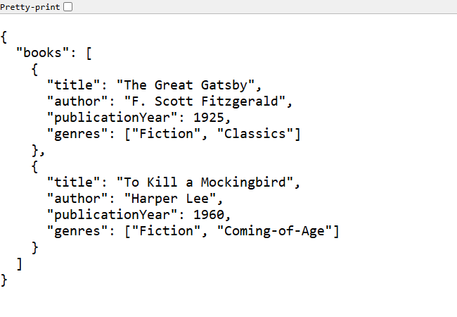
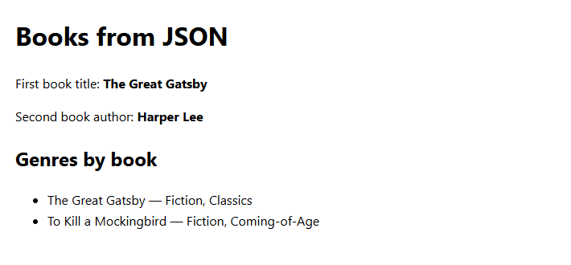
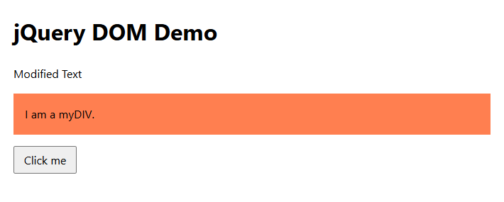

# Lab 4b · JSON and jQuery

This BIC21203 lab creates a book dataset, displays it with native JavaScript, and demonstrates three equivalent DOM operations in jQuery.

## Run locally

1. Open a terminal in this folder and run `php -S 127.0.0.1:8000`. On Windows with XAMPP, use `C:\xampp\php\php.exe -S 127.0.0.1:8000` if PHP is not on your PATH.
2. Open [the books page](http://127.0.0.1:8000/books.html) and [the jQuery demo](http://127.0.0.1:8000/jquery-dom.html) in a browser. The books page needs HTTP to fetch the local JSON. The jQuery demo needs internet access for the official jQuery 4.0.0 CDN.
3. In the jQuery demo, verify that the text reads **Modified Text**, the second block is coral with 16px of padding, and **Click me** opens an alert that reads **Button clicked!**.

## Results

### 1. JSON dataset

`books.json` parses successfully. It contains a top-level `books` array with two objects. Each object has a string title and author, a numeric publication year, and an array of genre strings.

### 2. Fetch and display

`fetch()` retrieves the dataset over HTTP, and `response.json()` parses it. The page uses `textContent` to display the first title, the second author, and the genres grouped by book. The browser check also verified the friendly error message for HTTP 404 and malformed JSON responses.

### 3. Native JavaScript and jQuery

- `.text()` sets the text, like assigning `textContent`.
- `.addClass()` applies the CSS class, like calling `classList.add()`.
- `.on("click", …)` attaches the click handler, like calling `addEventListener()`.

Native JavaScript can do these tasks without loading an external library. An existing application may still use jQuery when its interface depends on jQuery plugins.

